# 20261108_utsunomiya

<html lang="ja" data-loaded="false" data-scrolled="false" data-spmenu="closed">
<head>

<meta charset="UTF-8">
<meta http-equiv="Content-Type" content="text/html; charset=UTF-8">
<meta http-equiv="X-UA-Compatible" content="IE=EmulateIE10" />
<meta http-equiv="X-UA-Compatible" content="IE=edge">

<meta name="viewport" content="width=device-width, initial-scale=1.0">

<!--ここから上はお決まりの定型文です-->

<!--ここからが表現の書式などを決めるcssという部分-->

<link href="https://cdnjs.cloudflare.com/ajax/libs/lightbox2/2.7.1/css/lightbox.css" rel="stylesheet">

</head>

<body>
    
<!--
    
<a href="https://peyng.github.io/restart/">前回までの記録</a>><a>今回2026,05,28</a>

-->

モバイル端末をお使いの場合は、画面を横向きにすると
背景画像の横方向がご覧頂けます。

<!--ここ上は、ほぼそのまま使います！-->

<!--QRコードの挿入例-->

 QR for Access

<marquee direction="left" scrollamount="20" width="30%">(^_^)/~alis</marquee>

<!--流れ文字の挿入例-->
<h1><marquee behavior="left">!!! 2026/11/08、庭の夏みかんから、FKDのお花達、星空と朝焼けまで !!!</marquee></h1>

<!--ここから下が、本体部分-->

<h2>2026/Nov/07日、庭のみかんが色づき始めました、陽射しが強くてハレーション出てます</h2>
<a href="20261108_00001.jpeg" target="_blank">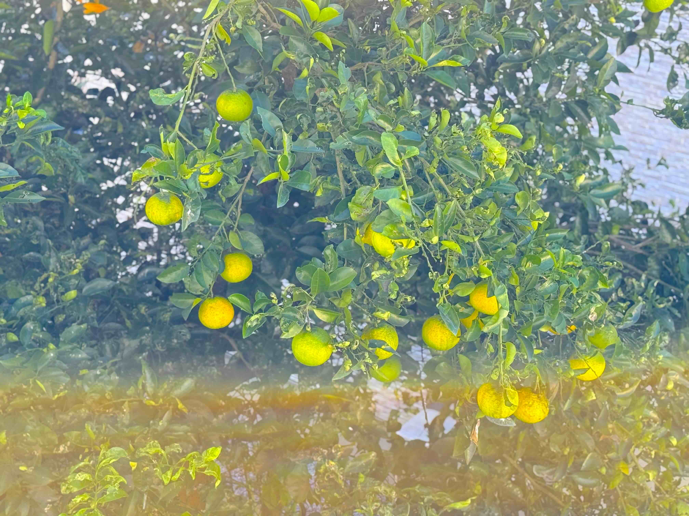</a>
<a href="20261108_00002.jpeg" target="_blank">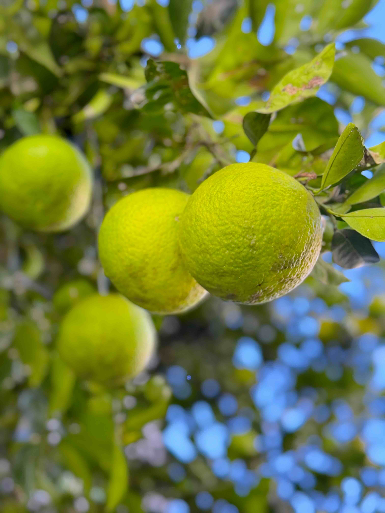</a>

<h2>一つ採って食べてみたら、ちょっと酸っぱいけどそろそろ食べ頃</h2>
<a href="20261108_00003.jpeg" target="_blank">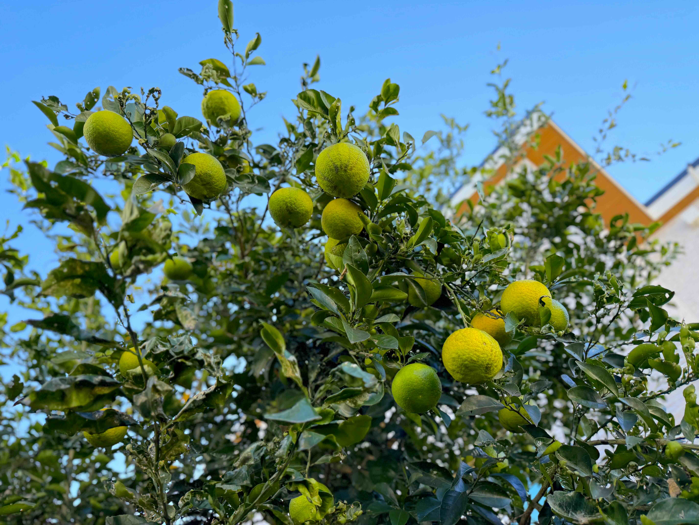</a>

<h2>庭のお花達も陽射しの下でみんな元気</h2>
<a href="20261108_00004.jpeg" target="_blank">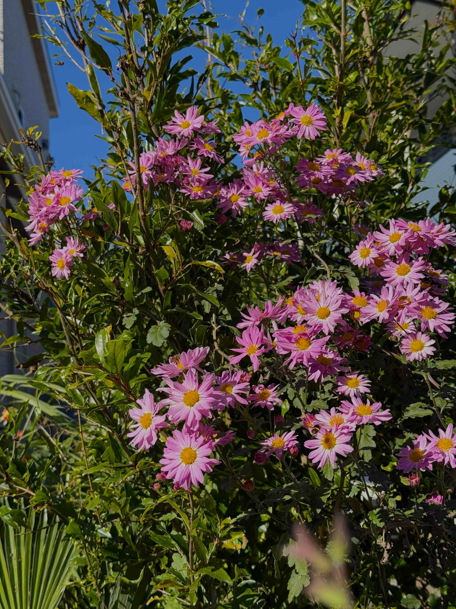</a>
<a href="20261108_00005.jpeg" target="_blank">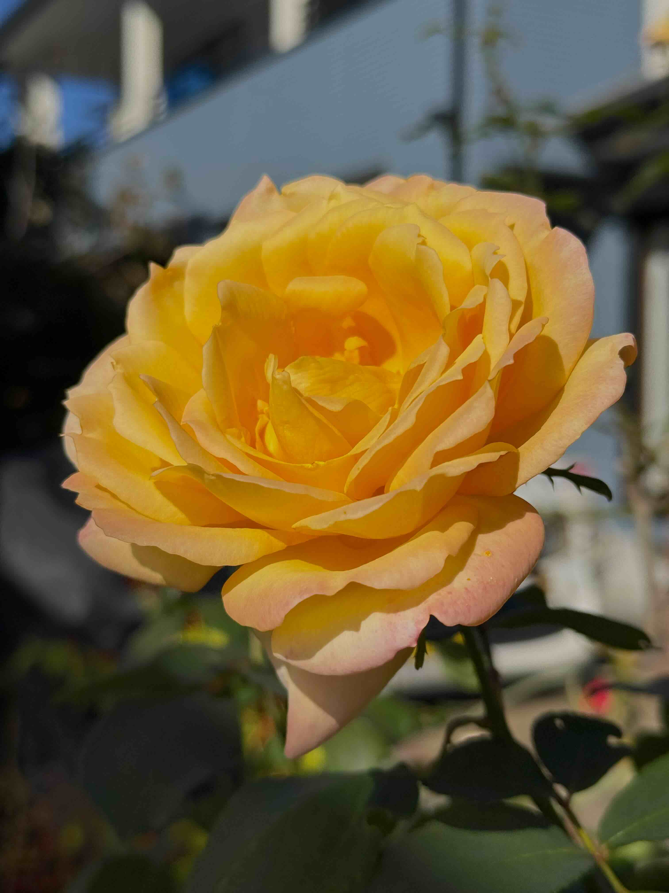</a>

<h2>お昼は大戸屋で、すけそうだらのあん掛け定食</h2>
<a href="20261108_00006.jpeg" target="_blank">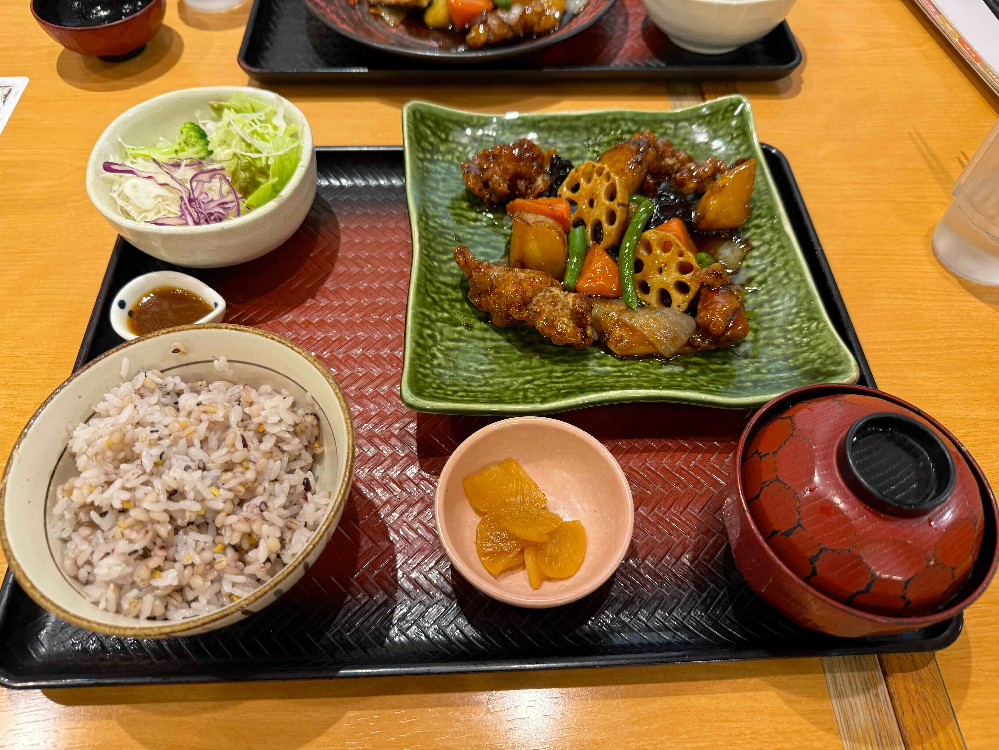</a>

<h2>FKDのお花屋さんでもお花達が皆元気にニッコリ</h2>
<a href="20261108_00007.jpeg" target="_blank">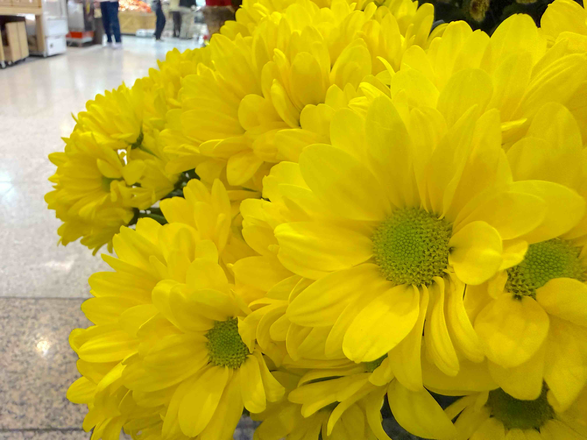</a>
<a href="20261108_00008.jpeg" target="_blank">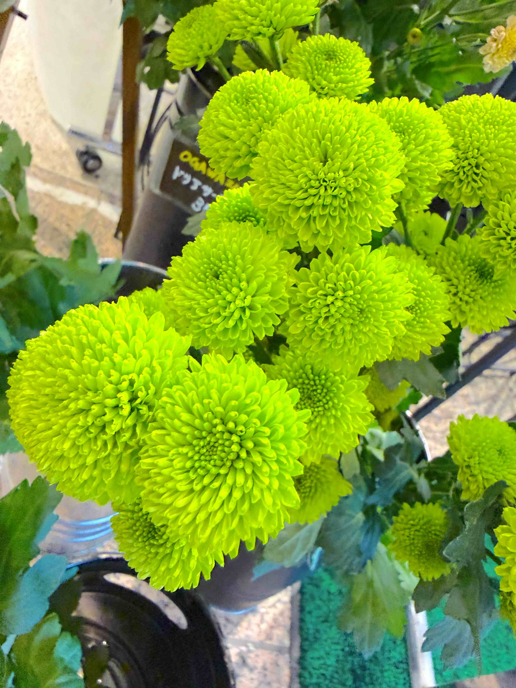</a>

<a href="20261108_00011.jpeg" target="_blank">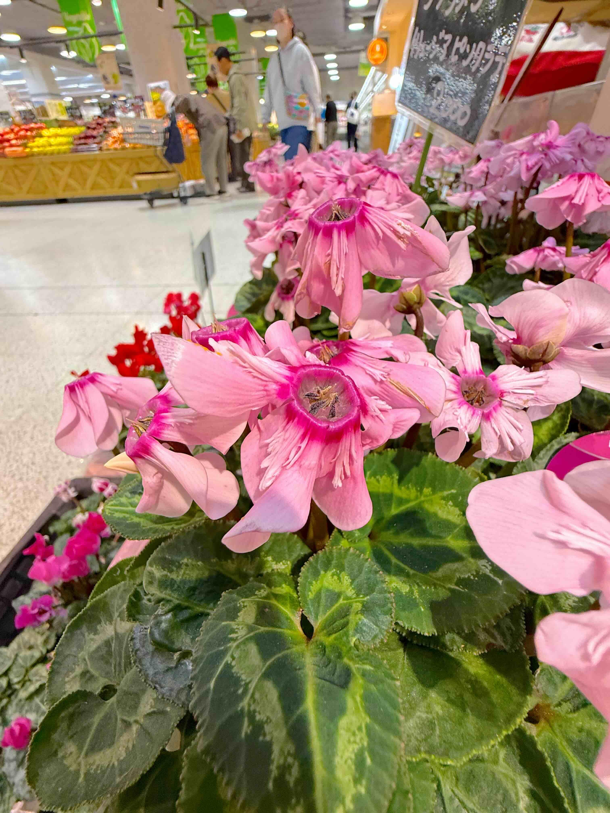</a>
<a href="20261108_00012.jpeg" target="_blank">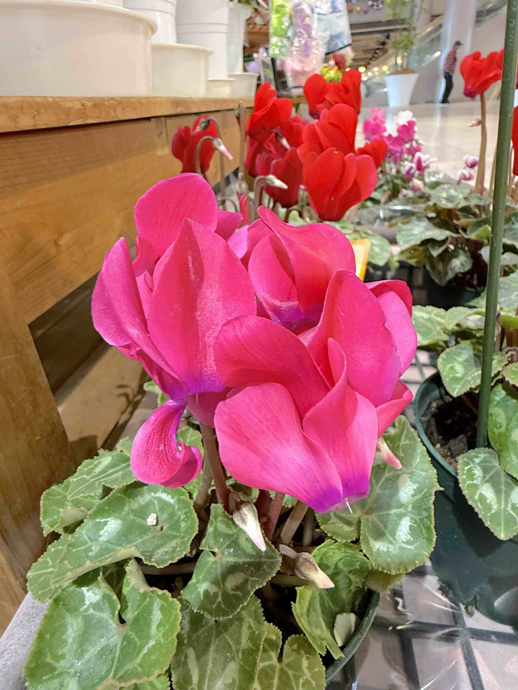</a>

<h2>3階天窓からの陽射しが眩しく差し込みました</h2>

<h2>8日に日付が変わった頃には満点の星空、北の空には北斗七星と北極星</h2>
<a href="20261108_00014.jpeg" target="_blank">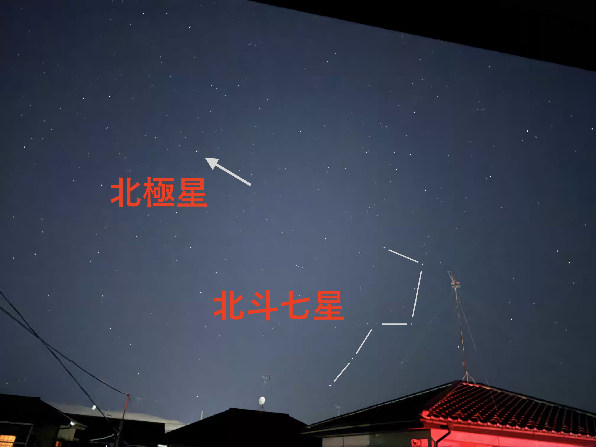</a>

<h2>ちょっと西にはカシオペア</h2>
<a href="20261108_00015.jpeg" target="_blank">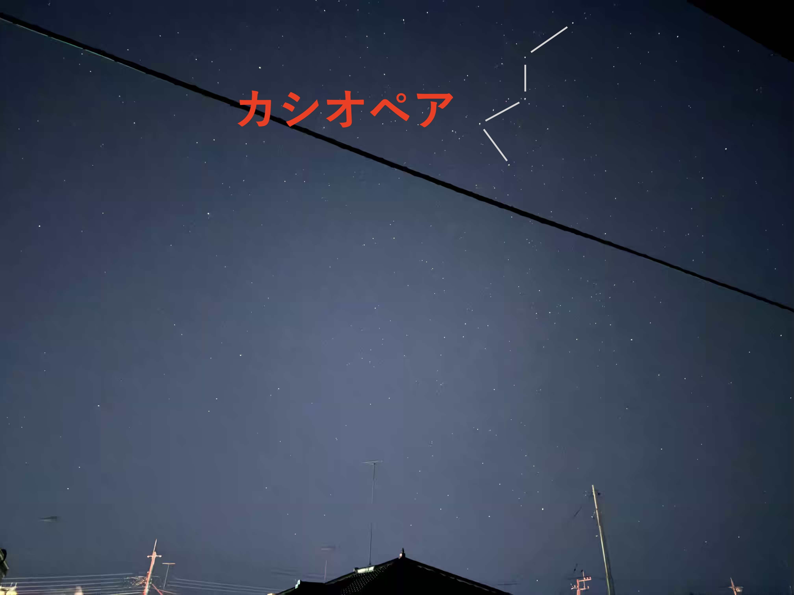</a>

<h2>南の空はプラネタリウム並みの満天の星、ペガススの方向を見ているはずだが、正座は辿れず・・・</h2>

<h2>6時前には朝焼けグラデーション</h2>

<h2>今日のBGMは、Ultimate Slow Rock Experience | Timeless Guitar Hits and Legendary Rock Classics</h2>

<iframe width="560" height="315" src="https://www.youtube.com/embed/pSuicp_dvoE?si=rjfcDsOqmaT4PWpQ" title="YouTube video player" frameborder="0" allow="accelerometer; autoplay; clipboard-write; encrypted-media; gyroscope; picture-in-picture; web-share" referrerpolicy="strict-origin-when-cross-origin" allowfullscreen></iframe>
    

   
<h2>2026Nov08、庭の夏みかんから、FKDのお花達、星空と朝焼けまででした Thank you for reading this far.</h2>
<!--
     
<h2>
<a href="https://torokoid.github.io/Mashiko_himawari_3/" target="_blank">クリックでメニューページに戻ります</a>
</h2>
-->

   

<!-- hitwebcounter Code START -->
<a href="https://www.hitwebcounter.com" target="_blank">

you are visitor The numbers are cumulative for the Bangkok ＆ Utsunomiya series websites launched since 2025 August 1st.
</a>   

<!--本体はここまで-->
    

<!--画面に空白地帯を作って、背景が見えるようにしています-->

<!-- フッタ -->
<footer>

Copyright 2026/11/08 alis

</footer>

<!--HPにさまざまなJavaScriptを呼び込むための書式-->

    
    </body>
    
</html>
